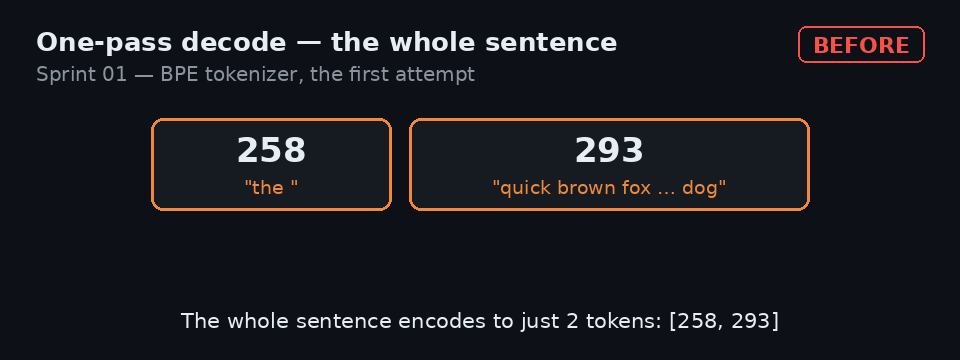
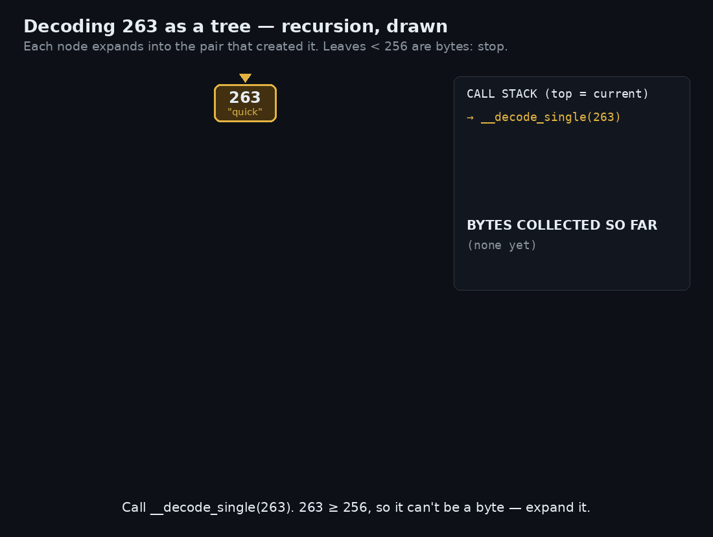

*Part 1 of a series on rebuilding the modern AI stack from first principles. The code and tests for this sprint are in the [ai-stack-sprints repository](https://github.com/Badjessa-git/ai-stack-sprints).*

## Why I'm doing this

I realized that I hadn't manually coded in a while. AI-driven development lets me move much faster, but I still believe coding by hand and understanding systems are valuable skills — and I could feel both dulling as AI took over more development work.

I had also been using LLMs for a while without understanding how they work. So I'm rebuilding the modern AI stack on my Mac mini, one piece at a time. I don't need to build GPT-5. My goal is to end up with something I can ping and get a response from.

The rules are simple:

- Every two weeks — or earlier if I have time — I'll complete a sprint and publish a post about it.
- AI sets up the scaffolding, benchmarks, and tests because I'm only doing this on weekends.
- All implementation code has to be written manually: no autocomplete and no AI-generated code.
- I can use the web for syntax, but I'll try to solve each problem myself first.

This is the first sprint: a tokenizer.

LLMs don't see the letters you type into a prompt composer. A tokenizer translates text into token IDs that a model can process, and translates token IDs back into text when the model responds.

## What I thought a tokenizer did

I didn't think much about tokenization before starting this. I knew it helped LLMs process input, but I had never looked at it closely.

The closest thing I had built was in my [multiplayer 3D chess game](https://wizardchess3d.vercel.app/), where game-state messages arrived as JSON, were parsed into event types and payloads, and were translated into updated state. Different problem, similar shape: convert one representation into another before the system can use it.

My naive model was that tokenization split text by a delimiter, transformed the pieces for efficiency, and sent them to the model's brain.

Instead, this implementation never starts with a delimiter. It starts with raw bytes and learns which adjacent sequences occur often enough to become units of their own.

## Building v1: count pairs, merge, repeat

The goal was to complete the round trip:

```text
text -> tokens -> original text
```

I started with two helper functions:

- `get_stats` counts each adjacent pair in a list of token IDs. The pairs overlap: in `[1, 2, 1]`, both `(1, 2)` and `(2, 1)` count.
- `merge_pair` returns a new list with every non-overlapping occurrence of a chosen pair replaced by a new token ID.

Together, they answer BPE's two central questions: *Which pair occurs most often?* and *What happens when we merge it everywhere?*

### Training

Training begins by encoding the text as UTF-8 bytes. The base vocabulary contains all 256 possible byte values, IDs 0 through 255. ASCII is included, but not the limit: characters outside ASCII become sequences of UTF-8 bytes.

The requested vocabulary must be at least 256. Each learned merge receives the next available ID, starting at 256.

The loop is:

1. Count the adjacent pairs in the current token list.
2. Pick the most frequent pair.
3. Record it in `self.merges` as `(left, right) -> new_id`.
4. Replace that pair throughout the token list.
5. Repeat until reaching the target vocabulary or running out of pairs frequent enough to merge.

Vocabulary size is the merge budget: 256 permits no learned merges; 512 permits up to 256.

At the end, `self.merges` is the learned rulebook. Encoding applies it to new text; decoding expands token IDs back into bytes and decodes them as UTF-8.

## Where it broke: decoding is not a one-pass operation

Decoding was the most challenging part of the tokenizer.

Encoding was comparatively straightforward: iterate through the merges in learned order and call `merge_pair` for each rule — one pass through the token sequence per rule.

My first decoding attempt was also iterative. For each input token that was the result of a merge, I replaced it once with the two IDs that created it. After one pass, I expected to have bytes that could be converted back into a string.

Here's the example that exposed the problem:

```python
tok = BPETokenizer()
tok.train(
    "the quick brown fox jumps over the lazy dog. " * 30,
    vocab_size=320,
)
encoding = tok.encode("the quick brown fox jumps over the lazy dog")
print(encoding)
```

Training stopped after 44 merges — IDs 256 through 299 — because no remaining pair met the minimum frequency. A few of those merges were:

```python
{
    (116, 104): 256,  # "th"
    (256, 101): 257,  # "the"
    (257, 32): 258,   # "the "
    # ... more merges ...
    (291, 111): 292,
    (292, 103): 293,
}
```

The entire sentence encoded to only two tokens:

```python
[258, 293]
```

But expanding each of those tokens once produced:

```python
[257, 32, 292, 103]
```

That was not a list of bytes. Token 257 still represented `"the"`, and token 292 represented almost the entire remainder of the sentence. Because 257 and 292 are greater than 255, they could not be placed in a `bytes` object at all. I was left holding a partially expanded sequence.



### Recursion was the missing idea

A merged token can contain another merged token. Expanding it once therefore doesn't finish the job; it merely reveals the next layer.

The fix was to treat every merged token as a small tree. The private `__decode_single` function returns an ID below 256 as a byte; otherwise, it finds the pair that created the ID and recursively expands both children until every leaf is a byte.

Then `decode` concatenates the bytes from every input token and decodes them as UTF-8. For the sentence above, recursion eventually produces the original 43 bytes.



The lesson from the bug was precise: **a token is not decoded merely because it has been replaced once. It is decoded when every value underneath it has reached a byte.**

## The numbers

I benchmarked three vocabulary sizes on the same small corpus. At only 4,646 bytes, the results reveal the shape of the trade-off better than they predict production performance.

```text
corpus: 4,644 chars / 4,646 bytes
vocab= 256  merges=  0  tokens= 4,646  ratio=100.00%  bytes/token=1.00  train=0.00s  encode=0.000s
vocab= 384  merges=128  tokens= 2,346  ratio=50.50%  bytes/token=1.98  train=0.10s  encode=0.041s
vocab= 512  merges=256  tokens= 1,882  ratio=40.51%  bytes/token=2.47  train=0.18s  encode=0.070s
```

At vocabulary 256, there are no learned merges, so every byte remains its own token: 4,646 tokens.

At vocabulary 512, the same text takes 1,882 tokens — **59.5% fewer tokens than the byte-level baseline**. Shorter sequences mean less input for a model to process per request.

The diminishing returns were just as interesting:

- The first 128 merges reduced the token count by 2,300.
- The next 128 merges reduced it by only 464.

BPE is greedy: frequent pairs are merged first, so later merges chase rarer patterns. Vocabulary size is a trade-off, not a case of “bigger is always better.”

## Why a dictionary — and why this version is slow

I used dictionaries in two central places.

`get_stats` uses an adjacent pair as a dictionary key so it can count occurrences as it scans the sequence. `self.merges` uses that same pair as a key and maps it to the new token ID.

The merges dictionary provides a second, less obvious benefit: Python dictionaries preserve insertion order. Because merges are inserted in the order they are learned, insertion order is also their rank. During encoding, the dictionary is both the rulebook and the priority list.

The trade-off appears in decoding. `self.merges` points forward, from a pair to a token ID. Decoding needs the reverse direction. My implementation searches for the pair when it needs it. I could build a reverse dictionary or precomputed token-to-bytes table, making lookups faster at the cost of extra memory and a duplicate representation. For a first pass, I left it out.

Training makes a similar trade. Each round, my code recounts every pair from scratch and sorts the counts to find the winner. If **M** is the number of merges and **N** is the current sequence length, repeated full scans cost roughly **M × N**, plus sorting.

That is more than necessary. When a pair is merged, only pairs immediately around each merge site change; counts elsewhere remain valid. An optimized implementation could update only those neighbors, but it would need considerably more bookkeeping to track changing counts and winners correctly.

The encoder makes the same simplicity trade: it scans the whole token sequence once for every learned merge rule.

Finally, a larger vocabulary shortens sequences, but with diminishing compression gains, while steadily increasing training work, the size of the model's embedding and output layers, and the number of rare tokens it must learn.

Those trade-offs are acceptable for a 4,646-byte learning corpus and a few hundred merges. They would not be acceptable unchanged at production scale.

## Next: Part 2

This version is correct, but deliberately naive.

In Part 2, I'll optimize it: avoid sorting every pair count merely to find the maximum, precompute the lookups decoding needs, and rerun the same tests and benchmark to see what actually improves. I'll also revisit the production-scale trade-offs — and what I misunderstood when I started — with the complete v1-to-v2 comparison in hand.
